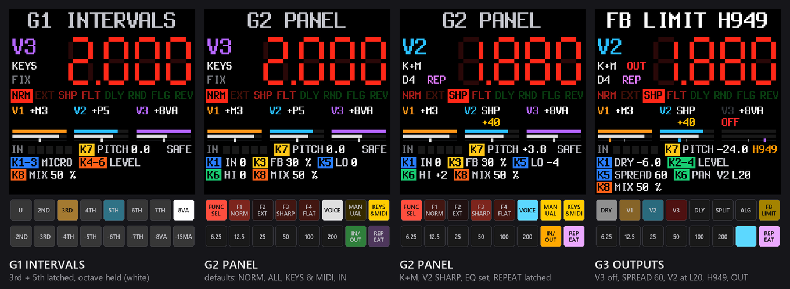
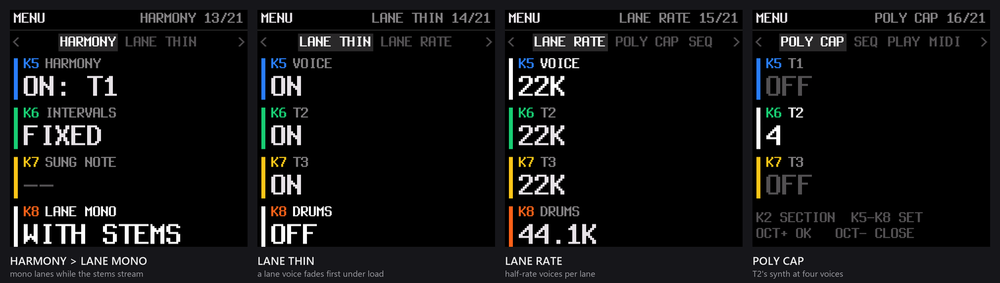

# Mewcoder + Harmoniser

SLOOP 2.8.4 for the M-Vave SMK-37 Elite with **Mewcoder's vocoder** and now **its own harmoniser**: your voice, or any
sound you choose, in over USB audio, played dry, through a **20-channel vocoder** modelled on the Sennheiser VSM201, or
into **up to three harmony voices** modelled on the Eventide H949, with a lane of it across every track. One of the
builds of [SLOOP for the SMK-37](https://github.com/MiloMeowzers/sloop-smk37). **Early testing / pre-release.**

**[Install](https://milomeowzers.github.io/sloop-smk37/harmoniser/webapp/installer/)** ·
**[Editor](https://milomeowzers.github.io/sloop-smk37/harmoniser/webapp/editor/)** ·
[Harmoniser manual](/HARMONISER.md) · [Vocoder manual](/VOCODER.md) ·
[Release](https://github.com/MiloMeowzers/sloop-smk37/releases/tag/mewcoder%2Bharmoniser-v0.2-pre)

> Unofficial firmware, not affiliated with or endorsed by M-Vave or Eventide. No warranty. **Back up the keyboard
> first** ([how](/SMK37.md#install)).

## The harmoniser

**HOME > HARMONY: ON** makes track 1 the harmoniser. Send your voice to it (HOME > SETUP > IN L or IN R: HARMONY) and
play intervals from T1's keys, the interval pads, MIDI or the sequencer.
- **Up to three harmony voices** with the H949's sound: formants that move with the pitch, a crossfaded splice, the
  memory at 22.05 kHz. FIXED intervals from C4, or SCALE: counted from the note you sing, in the song's key.
- **A lane across every track:** T2, T3 and the drums each harmonised on their own channel, at their own pan.
  **FADER BANK F** is each track's MIX (0 dry, 100 the harmony alone).
- **FADER BANK E:** PITCH (two octaves down to one up), FEEDBACK (cascades that always die away, or the H949's
  self-oscillation with FB LIMIT H949), VOICE IN, LANE RATE.
- **The HARMONY page** (HOME on the tracks screen): the PITCH RATIO readout, the HK940's interval pads, MICRO, LEVEL and
  pan per voice, SHARP / FLAT, MANUAL, the feedback EQ, REPEAT, IN / OUT.
- **The load settings** in the HOME menu: LANE THIN, LANE RATE, LANE MONO and POLY CAP. The vocoder is off while
  HARMONY is on.

## The vocoder (Mewcoder)

Everything from [Mewcoder v0.1](https://github.com/MiloMeowzers/sloop-smk37/releases/tag/mewcoder-v0.1): track 3 plays
the computer's audio dry or through the vocoder, two USB inputs each routed on the keyboard (TRACK 3, CARRIER, T1, T2,
HARMONY, OFF), SETUP, the vocoder page and the editor's tab, now **Vocoder · Harmony**.

**Left out to make room:** the built-in samples (your own samples work), the TEXTURE, DIGITAL, LOFI, VOICE, TRIO and
NOISE engines. Need them? Use [Multichannel USB audio](https://github.com/MiloMeowzers/sloop-smk37).

## Start

1. Back up the keyboard's flash ([how](/SMK37.md#install)) and your projects (the editor's Backup).
2. [Install](https://milomeowzers.github.io/sloop-smk37/harmoniser/webapp/installer/) (Chrome or Edge, over USB).
3. On the computer, send your microphone to the SMK-37's audio output (peaks around −10 dBFS).
4. HOME > INPUT > **AUDIO IN: ON**; HOME > HARMONY > **HARMONY: ON: T1**; HOME > SETUP > **IN R: HARMONY** (the side
   your voice is on).
5. Sing, and hold **G4** on T1: a fifth above you. Then raise a track's MIX on FADER BANK F.

The [harmoniser manual](/HARMONISER.md) has the rest, its known limits in
[A13](/HARMONISER.md#a13-pre-release-known-limits).

Branch `harmoniser` · release [`mewcoder+harmoniser-v0.2-pre`](https://github.com/MiloMeowzers/sloop-smk37/releases/tag/mewcoder%2Bharmoniser-v0.2-pre) ·
GPL-3.0-only
